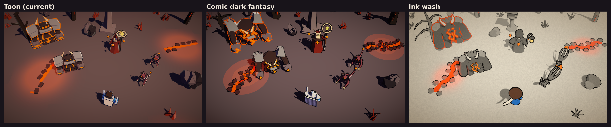
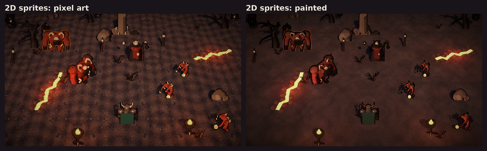
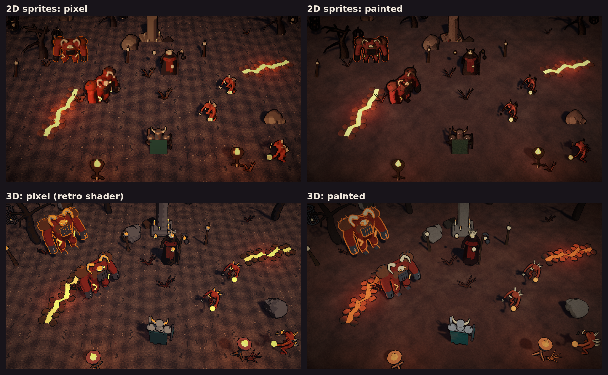
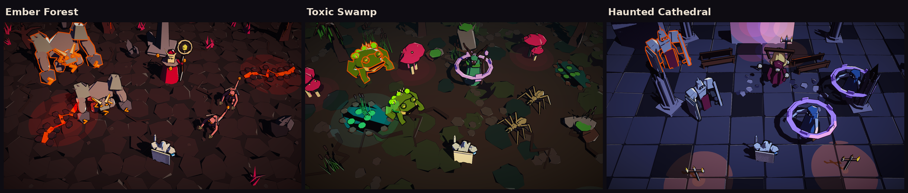

# Perfect Loot – Art Style Guide (test draft)

Branch: `art/toon-style-test`. Everything here is a proposal to evaluate, not final.

## 1. Direction in one sentence

**Stylized toon-shaded ARPG with a dark accent**: bold, chunky, outlined characters that read instantly from a top-down camera, set in moody biomes where *glowing trait cues* tell the player what each enemy does.

### Pillars
1. **Readability first.** Silhouette → color → glow, in that order. If an enemy's trait can't be read in a 1-second glance at gameplay zoom, the design fails.
2. **One shader unifies everything.** All models (Blender, Meshy, Tripo, asset packs) use `PerfectLoot/Toon`. Textures stay simple; the shader provides the style.
3. **Biomes change the palette, never the language.** Each biome has its own colors and shapes; trait cues are identical everywhere.
4. **Chunky, simple shapes.** No thin, floating or fiddly parts. Exaggerated proportions (big hands/heads/weapons).

## 2. Style line (paste into every Gemini prompt)

> stylized toon-shaded game art, chunky exaggerated proportions, bold simple shapes, clean cel shading, thick dark outlines, saturated colors with a moody accent, readable silhouette, fantasy ARPG

## 3. Gemini prompt templates

**Enemy / character (for Meshy image-to-3D + auto-rig)**
> Full-body [ENEMY DESCRIPTION], [STYLE LINE]. [BIOME PALETTE]. Standing in an A-pose (arms angled down 45°, legs slightly apart), facing directly forward, whole body visible head to feet. Trait cue: [TRAIT CUE FROM TABLE]. Plain pure white background, flat even lighting, no shadows, no props in hands, no text. Square image.

**Prop / environment piece**
> A single [OBJECT], [STYLE LINE]. [BIOME PALETTE]. Centered, full object visible, three-quarter view from slightly above. Plain pure white background, soft even lighting, no shadows, no other objects, no text. Square image.

**Extra views (better 3D)** – upload the first image, then:
> Show this exact same [character/object] from the side / from the back. Same pose, same style, plain white background.

**Consistency** – always upload one approved asset as a reference:
> Same art style as this image. Now make [NEW THING].

**Avoid:** dramatic angles, motion poses, scenery, glow halos (glow is added in-engine), thin details, text/logos.

## 4. Trait language (identical in every biome)

| Trait | Shape cue | Color / glow cue | Material setting |
|---|---|---|---|
| Fire / burn | cracks across body, ember vents | orange-yellow glow in cracks | Emission `#FF7A1A`, pulse 0.3 |
| Frost / slow | crystal growths on shoulders/back | pale cyan glow | Emission `#7FE6FF`, pulse 0.1 |
| Poison | bulbous sacs, drips | acid green glow | Emission `#8CFF3A`, pulse 0.4 |
| Physical armor | thick grey plates, bulky shoulders | no glow, metal grey `#8A8F99` | Rim strength 0.6 |
| Magic shield | floating rune plates, halo ring | violet glow `#B57BFF` | Emission + pulse 0.5 |
| Projectile reflect | mirror/crystal shell on front | white-silver rim | Rim `#FFFFFF`, strength 1.0 |
| Fast / evasive | thin long limbs, forward lean | — | — |
| Summoner | totem/staff silhouette, orbiting minions | gold glow `#FFD24A` | Emission |
| Elite modifier | larger scale (1.3×), extra spikes | colored outline | Outline color = trait color |

Rule: **a trait owns its color**. Biome palettes must avoid using trait glow colors on environment pieces at high saturation.

## 5. Biome palettes (test set)

| Biome | Base palette | Shadow tint | Shapes | Lighting mood |
|---|---|---|---|---|
| Ember Forest (volcanic) | ash grey `#3B3638`, charcoal `#221E20`, burnt bark `#5A3B2E` | deep purple `#2A1E3A` | jagged, broken, burnt trunks | dark, low warm key, lava point lights |
| Frozen Crystal Caves | ice blue `#9FC6E0`, slate `#4B5A73`, snow `#E8F0F7` | indigo `#2C2F5E` | angular shards, clean facets | cool blue key, cyan crystal lights |
| Toxic Swamp | murky green `#4E5B33`, mud `#5C4A35`, moss `#6F8A3C` | teal-brown `#22302A` | rounded, bulbous, drooping | hazy yellow-green fog, low key |
| Overgrown Ruins | warm stone `#B8A88A`, leaf green `#5E9A4A`, terracotta `#B5643D` | blue-violet `#4A4B7A` | broken geometric + soft foliage | bright warm sun, soft shadows |

## 6. Technical rules

- Shader: `PerfectLoot/Toon` for everything opaque. Base color via `_BaseColor` (flat) or a small hand-painted texture.
- Poly budget (guide): enemies 1.5k–6k tris, bosses ≤ 15k, props 50–1.5k.
- Scale: 1 unit = 1 m. Player ≈ 1.8 m. Pivot at feet/bottom center.
- Models for the toon pipeline go under `Assets/ArtStyleTest/Models/` (postprocessor bakes smoothed outline normals).
- Camera reference: ARPG 3/4 top-down, ~50° pitch, FOV 35–40. Judge readability at this view, never in close-up.
- AI-generated assets: always clean up in Blender (decimate, fix pivot/scale, simplify materials) before import. Disclose AI use on Steam as required.

## 7. How to judge the test scenes

For each biome, take a gameplay-angle screenshot and ask:
1. Can you name every enemy's trait without reading text?
2. Does the player stand out from enemies and from the ground?
3. Does it look like *one game* across all four biomes?
4. Does a thumbnail (≈300 px wide) still read clearly? (Steam capsule test)
5. Can you tell walkable ground from the drop and from props at a glance?

## 8. Style comparison (Ember Forest, same layout and cast)

| | Toon | Comic dark fantasy | Ink wash |
|---|---|---|---|
| Scene | `ArtStyleTest_EmberForest` | `ArtStyleTest_EmberForest_Comic` | `ArtStyleTest_EmberForest_InkWash` |
| Shader | `PerfectLoot/Toon` | `PerfectLoot/Comic` | `PerfectLoot/InkWash` |
| Models | `Models/` (blocky) | `Models/Comic/` (angular, jagged) | `Models/InkWash/` (flowing, organic) |
| Shape language | chunky boxes | hunched, spiky, slab armor, tattered cloth | rounded creatures, brush-stroke strands |
| Trait readability | glow on dark | glow + ink contrast | strongest: only traits/player have color |
| Pipeline fit (AI models) | needs clean shapes | very forgiving (ink hides flaws) | very forgiving (brush outlines) |
| Biome variety | palette swaps | palette + hatch density | paper tone + ink density; color budget is tight |

Notes:
- Same cast in every version: Player, Cinder Brute (fire + armor), Ash Imp (fast), Magma Shaman (summoner), Elite Cinder Brute (trait-colored outline).
- Ink wash rule: environment and enemy bodies are ink only; color is reserved for traits, hazards and the player.
- Comic rule: hatching only in shadow; glowing trait parts never get hatched.

## 9. 2D sprite test (Doom-style billboards, dark medieval)

Scenes: `ArtStyleTest_EmberForest_Sprite_Pixel`, `ArtStyleTest_EmberForest_Sprite_Painted` (all assets in `Assets/ArtStyleTest/Sprites2D/`).

Cast (new Doom-medieval designs, same trait roles): horned great-helm knight (player), Hell Baron with furnace chest (fire + armor), lanky spiked Imp with fireball (fast), Skull Priest with censer and floating skulls (summoner), Elite Baron (trait-colored outline).

How it works:
- Sprites are **pre-rendered** from 3D models in Blender (`ArtSource/EmberForest_ArtTest.blend`, collection `Doom_Models`): orthographic camera at the game camera's pitch (looking down 50°), 8 rotations per actor, transparent PNGs.
- `ArtSource/Tools/make_sprites.py` turns the renders into two sets:
  - **Pixel**: 22 px per meter, 37-color dark medieval palette, 1 px outline; the game camera renders at 270 px tall (`PixelArtCamera`, play mode).
  - **Painted**: 384 px frames, flattened brush blotches, ink edges, canvas grain, 3 px ink outline.
- `SpriteBillboard` keeps sprites parallel to the camera (feet pivot on the ground); `DirectionalSprite` picks 1 of 8 frames from the angle between the actor's facing and the camera (Doom style).
- `PerfectLoot/SpriteLit`: cutout sprites that write depth, receive sun/shadows/point lights, cast shadows; bright warm pixels glow (bloom).

Replacing placeholders with hand-drawn or Gemini art: keep the same file names, square frames, feet pivot and 8 rotations (frame 0 = facing the camera, then 45° steps turning to screen-right). Re-run the importer settings and the prefabs pick them up.

Caveats: SpriteRenderer is not supported by Entities Graphics, so actors would stay GameObjects (or use custom quad rendering) if this direction is chosen.

## 10. Doom-medieval in 3D (same cast and layout as the sprite test)

Scenes: `ArtStyleTest_EmberForest_Doom3D_Pixel`, `ArtStyleTest_EmberForest_Doom3D_Painted`. Models: `Models/Doom/` (the same Blender models the sprites were rendered from).

- **3D pixel**: `PerfectLoot/Retro` shader: 3 lighting bands with 4×4 Bayer dithering, stepped point-light pools, color snapped to the same 37-color palette as the sprites, 1 px outline; low-res `PixelArtCamera` (270 px tall) in play mode. No tonemapping/color grading so the palette survives.
- **3D painted**: `PerfectLoot/InkWash` in full-color mode (`_ColorKeep = 1`): brushy shading bands, rough brush outlines, grain; film grain post.

Sprite vs 3D, same look:
| | 2D sprites | 3D |
|---|---|---|
| Rotation | 8 fixed angles (pops between frames) | smooth, any angle |
| Animation | every frame × 8 directions must be drawn/rendered | one rig, any animation (Mixamo etc.) |
| Entities Graphics | not supported (GameObjects) | supported (shaders are DOTS-instancing ready) |
| Hand-drawn art | yes, real sprites can replace the placeholders | shader-generated look only |
| Runtime cost | cheap quads, more texture memory | more triangles, small textures |

### 3D retro: chosen direction, first polish pass

- **Pixelation is a plain scene setup (no script)**: the orthographic camera (pitch 50°, size 5.2) renders into `Rendering/RT_Pixel_480x270` (point filter, set as the camera's *Output → Target Texture*), and the `Pixel Display` canvas shows it full-screen with a Raw Image + Aspect Ratio Fitter (16:9). The Game view shows the pixel image in edit mode too; the Scene view stays full-res. To change the pixel size, change the render texture's size.
- **No pixel snapping yet**: edges may shimmer slightly when the camera moves. If that bothers you, add a small follow script that rounds the camera position to whole pixels (world units per pixel = 2 × orthographic size ÷ 270). (`PixelArtCamera.cs` still exists for the sprite pixel scene and contains a full snapping version.)
- **Readability**: the player has a bone-white crest, cape emblem and a light-teal 1 px outline. Enemy outlines use their trait color (Baron fire `#C8501C`, Imp fast `#D7C7A6`, Priest summoner `#FFD36A`); the Elite gets a 2 px `#FFA53A` outline. Per-actor material copies live in `Materials/Doom3D_Pixel/ActorOutlines/`.
- Lava and fire glow toned down to deep orange so they don't read as yellow/gold (gold = summoner).

## 11. Comic dark fantasy across biomes

Scenes: `ArtStyleTest_Swamp_Comic`, `ArtStyleTest_Cathedral_Comic` (same layout and camera as Ember Forest). Models: `Models/ComicSwamp/`, `Models/ComicCathedral/` (Blender source `ArtSource/ComicBiomes_ArtTest.blend`, helpers in `ArtSource/Tools/pl_blender.py`).

| Biome | Cast (trait) | Mood |
|---|---|---|
| Toxic Swamp | Bloat Toad (poison), Mire Crawler (fast), Bog Shaman (magic shield), Elite Toad | plum-brown mud, jade moss, teal bog pools, glowing rose mushrooms, warm low sun |
| Haunted Cathedral | Armored Revenant (armor), Wraith (magic shield), Bell-Ringer (summoner), Elite Revenant | lilac stone, burgundy cloth, cold moonlight, warm candles, ruby/sapphire stained glass |

**Palette direction: "dark fairytale".** Serious and moody (dark values, ink, hatching) but with rich jewel-tone accents instead of grey-brown mud, so it also appeals to players who aren't into grimdark:
- Keep values dark and contrast high; put the saturation in a few accents per biome (rose, teal, ruby, sapphire, candle-gold).
- Warm key light + cool/teal shadows: inviting, not bleak. The grading pushes this further: Shadows Midtones Highlights in the biome's volume profile (section 15).
- Accent colors must not collide with trait colors (poison green, shield violet, summoner gold, fire orange). Pink/rose and teal are free for environment use.
- Gore stays minimal; menace comes from silhouettes, not blood.
- The palette lives in the Unity material builder (Blender colors are only the starting point), so a biome can be recolored without re-exporting models.

## 12. Building a tileset

References: `Docs/inspiration/Tileset/`. Take the principles from those pictures, never their assets, names or exact designs.

- **Platforms over a drop.** Build walkable ground as platforms, ledges and bridges above a drop (chasm, lava pit, bog, void) wherever the biome allows, instead of one big flat floor. The drop frames the walkable area and gives depth at gameplay zoom.
- **Depth fog.** The drop fades into one fog color per biome, so walkable edges read as dark silhouettes against it. The fog color comes from the biome palette and is never a trait hue at high saturation.
- **The world falls away, it never stops.** Past the level's edge the background ring curves down into the drop, everything below the level fades into the biome's abyss color, mist sheets drift at a few depths, and large silhouettes (spires, ruin towers, floating islands) stand far out in the fog. No piece of the backdrop ever rises above the level.
- **Calm floors.** Floors are mid-dark, low contrast, with only a subtle tile pattern. Detail goes on walls, rails and edges. An actor's base color is always brighter than the floor under it.
- **Clear edges.** Every walkable edge has a rim: railing, low wall, cliff lip or spikes, in the biome's shape language.
- **Tall pieces may hide players.** Walls, cliffs and tree canopies can stand in front of a player; the player then shows as a cool light blue outline through them (the Comic shader's Player X-Ray passes, Hidden Outline in CameraSettings). Nothing fades or opens, so don't shrink tall scenery for the camera's sake.
- **Props stay off walkable tiles.** Props go on edges, corners, walls and background pieces. Only rarely put a prop on a walkable tile, and only when it is meant to be an obstacle or a landmark. Keep combat space clear.
- **Light sources are part of the kit.** Torches, braziers, candles, lava cracks and glowing pools sit along edges and make warm pools of light, with darkness between them. Warm local light against cool fog. Key rooms may get one cold light shaft from above.
- **Arena landmarks.** Each arena or key room gets one large floor emblem or dais. Its glow uses the biome accent, never a trait color.
- **Height pieces.** Stairs, raised daises, pillars rising out of the drop, floating debris in the fog.
- **Biome color.** One dominant hue for fog and stone tint, plus one opposite accent for light sources.

**Minimum tile kit per biome**

| Group | Pieces |
|---|---|
| Ground | floor tiles (2–3 variants) |
| Edges | edge / cliff piece: straight, inner corner, outer corner; railing |
| Connections | bridge segment, stairs |
| Height | pillar, raised dais |
| Landmark | arena floor emblem |
| Light | 2–3 light-source props |
| Clutter | 3–4 edge-clutter props |
| Drop / background | spires, rocks or ruins that stand in the fog below the walkable level |

## 13. Skill VFX

References: `Docs/inspiration/Skills/`.

- **Domes and shields:** bright glowing rim, a glowing ring where the effect cuts the ground, a subtle inner pattern (veins, hexagons, runes), and a mostly transparent middle so gameplay stays readable.
- **Fire:** hard-edged stylized blobs, not realistic smoke. Gradient along the length from a white-hot core to yellow, orange and a red fringe, breaking into ember shapes at the tip.
- An effect's color follows its element or trait color (section 4).
- Effects are the brightest things on screen; the environment stays darker and less saturated around them.
- **VFX Graph** effects are built in code like the rest (`Tools/VFX/Build Fire Graphs`, `Build Ambient Graphs`; `Assets/Scripts/Editor/VfxGraph/`), with their behavior in Custom HLSL files under `Assets/Data/Vfx/Graphs/HLSL/` (one function per file). They still open in the VFX Graph editor for tweaking, but a rebuild overwrites hand edits, so change values in the builder or the HLSL. Sprites are hard-edged comic shapes (puff, leaf, dot); fire puffs use alpha clipping so their edges stay hard, and they shrink away instead of fading.
- **Lights on effects:** a fireball carries a point light and its impact flashes one; the comic shader draws them as flat two-step pools, and they glow in the height fog. No shadows, at most `VfxManager.MaxLights` (16) lit at once. Give an effect a light by adding it to the prefab's `VfxInstance.Lights`.

## 14. Biome tile sets (procedural)

`Tools/Level/Biomes/Build All Biome Tile Sets` (`Assets/Scripts/Editor/Level/BiomeTileSets.cs`) builds four WFC tile sets without Blender models: `BiomeTileGenerator` turns each tile's four corner terrains into floor, rock walls and liquid with marching squares, so any two tiles with matching corners meet seamlessly in every rotation. Everything lands in `Assets/Data/Level/Biomes/<Biome>/`. `Tools/Level/Biomes/Apply Biomes To Test Levels` points each test level at its biome and sets its light, ambient, fog, sky, post-processing and ambient particles.

| Biome | Test level | Liquid | Accents | Ambient |
|---|---|---|---|---|
| Ember Depths | Test Kill Enemies | lava (deep red-orange, crust plates, glowing shore) | magma seams at wall feet, magma cracks in the floor | rising embers |
| Drowned Mire | Test Survive | teal swamp water with foam and ripple lines | rose glowing mushrooms, puddles | rose spores |
| Frozen Hollow | Test Kill Boss | dark sapphire water | sapphire crystals on walls, frost cracks | snow |
| Abyssal Ruins | Test Reach Exit | a bottomless chasm fading into teal fog (the level border is chasm too) | teal rune circles, teal glow on chasm edges | teal motes rising from the drop |
| Brightwater Hollow | Brightwater Hollow | bright teal rivers and ponds with low earthy banks, crossed by rope bridges | rose and white flowers, birch-white trunks, a few warm yellow-green crowns | warm pollen drifting in the sun |

**Brightwater Hollow is the bright exception.** The first dungeon is meant to feel welcoming, so its values are lighter than the dark fairytale biomes: jade grass (never the poison trait's acid green), a muted dirt road, warm sun with cool teal shadows, and a light green-teal mist the world fades into. The ink, hatching and outlines stay the same, and enemies must still be brighter than the grass. The forest is the wall: tree walls grow taller deeper in, with bushes, stones and young trees at the edge and a low fringe of bushes and stones on the grass, so it never rises straight up. Canopies and bushes sway in the wind (PL_Comic's Sway, per material); bushes and grass tufts also bend around players and skills (section 16).

Rules the builder follows (sections 11 and 12):
- Floors are a 512 px texture per tile with a seam along every border, so tiles meet in any rotation. Colors ×0.85, close in value.
- Walls, rocks and banks use `PerfectLoot/Comic` with the environment settings. Glowing accents use the glowing-parts settings and free accent hues only (rose, teal, sapphire, deep lava red-orange).
- Props stay off walkable space: pebbles at wall feet, stones on pool rims, growths on wall tops. Floor features (cracks, runes, puddles) are flat and walkable.

Shaders made for surfaces the comic shader can't animate (the only exceptions to "one shader"):
- `PerfectLoot/Liquid`: water and lava. UV0.x is the distance to the shore, so foam and the shallow band survive the level's mesh merging.
- `PerfectLoot/Glow`: additive light pools on the floor around lava and chasms, in stepped bands, instead of point lights (the comic shader's point light reach is short).
- `PerfectLoot/Chasm`: the walls and bottom of a drop fading into fog by depth (UV0.y).
- `PerfectLoot/FogSky`: a sky in the scene's fog color, so nothing beyond the level shows a gray void. Also used in the Hub and cathedral scenes. Below the horizon it takes the abyss color while a level has a backdrop.
- `PerfectLoot/Mist`: transparent sheets of drifting, hard-banded mist in the abyss color (the backdrop's mist layers).

**Backdrop** (`LevelBackdrop` asset per biome, set on a level's Backdrop field): the background ring sinks away from the level's edge (Ring Sink, meters at its outer edge), everything below the level fades in hard steps to the abyss color (`PL_Abyss.hlsl`, used by the Comic, Chasm, Liquid and Glow shaders; global values set while the level exists), the mist prefab spawns at the level's center, and the silhouette pieces are scattered around the ring from the level's seed, each with its top below the ground. Pieces are modelled in Blender with `ArtSource/Tools/pl_backdrop.py` (pivot at the top, the kit's material slots) and exported to `Models/Backdrop/`; `BiomeKitBuilder` turns them into prefabs and fills the asset. Abyssal Ruins uses the chasm's teal `#123E44` as its abyss color. Brightwater Hollow's pieces are wooded hills, a ridge, a grove and a mossy crag (`kind="forest"`). Its ring sinks by -2 m: the background forest rises a little toward its outer edge, so the clearing sits in a bowl of trees that seem to grow bigger further out, with green-teal mist and the wooded hills beyond.

To add a biome: add an entry to `BiomeTileSets.All` (palette from section 11's table style, a `Style` for the geometry), rebuild, then apply or set a level's Tile Set by hand.

Screenshots (gameplay camera): `screenshots/Biome_EmberDepths.png`, `Biome_DrownedMire.png`, `Biome_FrozenHollow.png`, `Biome_AbyssalRuins.png`; the placeholder look they replaced: `Biome_Before_Placeholder.png`.

## 15. Canopy light and height fog

Two volume settings, set per biome in its volume profile and drawn by `ForestAtmosphereFeature` on `PC_Renderer`. Tune them in the inspector of the biome's `_Volume.asset`; `BiomeTileSets` (`CanopyShade`, `Mist`, `MistIntensity`) only fills them in when the profile doesn't have them yet.

- **Canopy Light** (`PL_Canopy.hlsl`): leaf shade shaped like cartoon clouds (clumps of round puffs with scalloped edges), hanging at the canopy height and projected down along the sun, plus big puffy cloud shadows drifting over. In `PerfectLoot/Comic` the leaf shade is its own lighter tone between sun and shadow (`Strength`), with light hatching (`Hatching`) and a slightly soft edge (`Edge Softness`); real shadows keep the hard split. Clouds only dim the sun. Water darkens a little under both. Treetops get only the clouds. Costs next to nothing.
- **Height Fog** (`PL_HeightFog.shader`): low mist over the ground in hard bands, drifting in patches. It reaches higher and is thicker toward the forest (the level's forest mask, built from the solved terrain) and glows where sun falls through canopy gaps (light shafts). It's drawn before transparents, so telegraphs, water, bars and VFX stay on top. It's one full-screen pass per camera; `Draw Fog` on the feature turns it off for a cheaper quality level.
- Keep the open-ground mist below knee height so characters read from the waist up.
- **Tilt Shift** (`PL_TiltShift.shader`, `BiomeTileSets.TiltShift`): a miniature-diorama blur at the top and bottom of the screen, drawn before post-processing so the HUD stays sharp. It works in screen space, so it doesn't change when the camera zooms out. `Strength` is the blur at the very edge in pixels at 1080p (Brightwater 4; keep it at 6 or less for readability). `Focus Height` is the share of the screen's height in the middle that stays sharp (0.6), and `Softness` is how gradually the blur fades in (0.3). `Draw Tilt Shift` on the feature turns it off.
- **Ink Edges** (`PL_InkEdges.shader`, `BiomeTileSets.InkEdges`, Brightwater only for now): comic ink lines (`#120C16`) inside shapes and where things stand on or in front of the ground, found from the depth and normals. The materials' outlines trace silhouettes only. A depth line needs a real step (`Smallest Step`, 0.4 m), so grass tufts and pebbles keep only their own outline and the floor stays quiet; a crease needs a sharper bend than `Crease Angle` (45°, lower draws lines across faceted props). Lines are 1 px at 1080p (`Width`), drawn before the height fog so far lines sink into the mist, hidden under water and faded into the abyss below the level. `Strength` 0.85; `Draw Ink Edges` on the feature turns it off.
- **Hit pulse** (`Assets/Settings/HitPulse_Volume.asset`): chromatic aberration (0.6) and a bloom boost (1.2), blended in for a moment on big crits and boss intros. Only for hits that matter, so it stays special; tune when it fires in `CameraSettings` (Hit feedback).
- **Grading** (URP Shadows Midtones Highlights, `BiomeTileSets.Toning`): shadows lean toward the biome's `ShadowTint` (teal) and highlights toward its `HighlightTint` (warm), `Toning` of the way from neutral (Brightwater 0.3). Midtones stay neutral so the accents keep their color. Don't use Split Toning: it turned every biome brown.

## 16. Ambient life and the mist wake

- **Ambient graph** (`LevelLayoutAuthoring.AmbientGraph`, set per biome in `BiomeTileSets`): one VFX graph over the whole level, so every player sees the same. Brightwater Hollow's has fireflies in the forest (pale warm candle, never Summoner gold), pollen over the clearings, leaves falling at the forest's edge and lying a while, mist wisps drifting downstream over the water, and splashes where rivers pass bridges and rocks. It replaces the camera-following ambient particles for biomes that have one; `LevelAmbientGraphView` hands it the forest mask, ground height and water points.
- **Mist wake** (`MistWake`, `VfxMist`): skills push, swirl and clear the height fog's mist, and it slowly fills back in. Fire burns tunnels and blows it away where it lands, tornadoes and whirlwinds swirl it, dashes shove it aside, Undertow pulls it in and players leave a faint trail. A new effect stirs the mist by adding a rule to `VfxMist.Rules`.
- **Bending foliage** (`PL_Foliage.hlsl`, PL_Comic's `Bend` and `Bend Height`): bushes and grass tufts lean out of the way of every player (`FoliagePushSystem`, up to 8, 1.3 m around each) and lean with the mist wake, so every skill that stirs the mist bends them too and they straighten as it refills. They lean more toward their top and stay planted: the level bakes each vertex's height above the bottom of its own small piece (`LevelGeometryExtractor`, UV2), and pieces over 3 m across (ground, skirts, walls) never bend. Brightwater's Bush (bend height 1 m) and KitFloorAlt (the tufts, 0.3 m) bend; flowers are flat and don't.

## 17. Water foam and ground decals

- **Water** stays a flat comic color. Two foam additions in `PL_Liquid.shader` (water mode only):
  - A hard white ring wherever something stands in the water (rocks, posts, fish). It compares the depth texture, which has no water in it (the Forest Atmosphere feature forces a depth-normals prepass), with the water's own depth. The riverbed lies deeper than the ring's width (`Edge Foam Width`), so it never foams.
  - Foam flecks drifting downstream on rivers (`River Foam Flecks`, `Fleck Scale`), carried like the ripples.
- **Decals** use URP's Decal feature in DBuffer mode, albedo only, on `PC_Renderer`. They tint the floor before it's lit, so they get the two tones, hatching, leaf shade and fireball light pools.
  - Only materials with **Receive Decals** on take them: the floor-template materials (`BiomeTileSets.Comic` sets it for `ComicFloor`). Units, props and rocks never get painted.
  - Sprites are drawn in code (`Tools/VFX/Build Decals`, `DecalBuilder`) with hard edges, flat colors, and low contrast on floors.
  - **Level decals** (`LevelDecalSet`, per biome; Brightwater Hollow only for now): moss and fallen leaves along the forest's edge, mud by the water, small rose and off-white flower patches in clearings. They're placed from the level seed, so every machine paints the same.
  - **Ground marks** (`GroundDecals`): scorch where a fireball lands, frost from Cold Nova, and the slimes' trails (`SlimeTrailAuthoring` on the slime prefab). They hold for a few seconds, then fade; at most 64 at once. An effect leaves one through `VfxInstance.GroundMark`.
