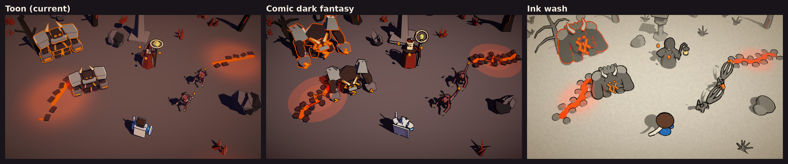
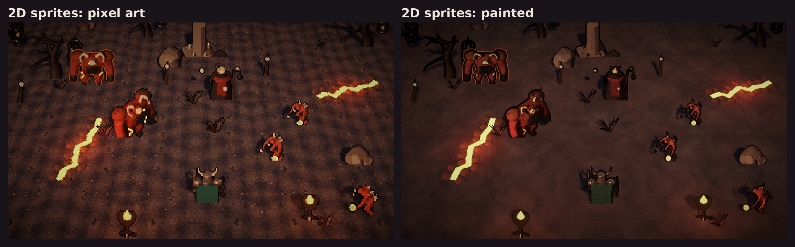

# Perfect Loot – Art Style Guide (test draft)

Branch: `art/toon-style-test`. Everything here is a proposal to evaluate, not final.

## 1. Direction in one sentence

**Stylized toon-shaded ARPG with a dark accent**: bold, chunky, outlined characters that read instantly from a top-down camera, set in moody biomes where *glowing trait cues* tell the player what each enemy does.

### Pillars
1. **Readability first.** Silhouette → color → glow, in that order. If an enemy's trait can't be read in a 1-second glance at gameplay zoom, the design fails.
2. **One shader unifies everything.** All models (Blender, Meshy, Tripo, asset packs) use `PerfectLoot/Toon`. Textures stay simple; the shader provides the style.
3. **Biomes change the palette, never the language.** Each biome has its own colors and shapes; trait cues are identical everywhere.
4. **Chunky, simple shapes.** No thin, floating or fiddly parts. Exaggerated proportions (big hands/heads/weapons).

## 2. Style line (paste into every Gemini prompt)

> stylized toon-shaded game art, chunky exaggerated proportions, bold simple shapes, clean cel shading, thick dark outlines, saturated colors with a moody accent, readable silhouette, fantasy ARPG

## 3. Gemini prompt templates

**Enemy / character (for Meshy image-to-3D + auto-rig)**
> Full-body [ENEMY DESCRIPTION], [STYLE LINE]. [BIOME PALETTE]. Standing in an A-pose (arms angled down 45°, legs slightly apart), facing directly forward, whole body visible head to feet. Trait cue: [TRAIT CUE FROM TABLE]. Plain pure white background, flat even lighting, no shadows, no props in hands, no text. Square image.

**Prop / environment piece**
> A single [OBJECT], [STYLE LINE]. [BIOME PALETTE]. Centered, full object visible, three-quarter view from slightly above. Plain pure white background, soft even lighting, no shadows, no other objects, no text. Square image.

**Extra views (better 3D)** – upload the first image, then:
> Show this exact same [character/object] from the side / from the back. Same pose, same style, plain white background.

**Consistency** – always upload one approved asset as a reference:
> Same art style as this image. Now make [NEW THING].

**Avoid:** dramatic angles, motion poses, scenery, glow halos (glow is added in-engine), thin details, text/logos.

## 4. Trait language (identical in every biome)

| Trait | Shape cue | Color / glow cue | Material setting |
|---|---|---|---|
| Fire / burn | cracks across body, ember vents | orange-yellow glow in cracks | Emission `#FF7A1A`, pulse 0.3 |
| Frost / slow | crystal growths on shoulders/back | pale cyan glow | Emission `#7FE6FF`, pulse 0.1 |
| Poison | bulbous sacs, drips | acid green glow | Emission `#8CFF3A`, pulse 0.4 |
| Physical armor | thick grey plates, bulky shoulders | no glow, metal grey `#8A8F99` | Rim strength 0.6 |
| Magic shield | floating rune plates, halo ring | violet glow `#B57BFF` | Emission + pulse 0.5 |
| Projectile reflect | mirror/crystal shell on front | white-silver rim | Rim `#FFFFFF`, strength 1.0 |
| Fast / evasive | thin long limbs, forward lean | — | — |
| Summoner | totem/staff silhouette, orbiting minions | gold glow `#FFD24A` | Emission |
| Elite modifier | larger scale (1.3×), extra spikes | colored outline | Outline color = trait color |

Rule: **a trait owns its color**. Biome palettes must avoid using trait glow colors on environment pieces at high saturation.

## 5. Biome palettes (test set)

| Biome | Base palette | Shadow tint | Shapes | Lighting mood |
|---|---|---|---|---|
| Ember Forest (volcanic) | ash grey `#3B3638`, charcoal `#221E20`, burnt bark `#5A3B2E` | deep purple `#2A1E3A` | jagged, broken, burnt trunks | dark, low warm key, lava point lights |
| Frozen Crystal Caves | ice blue `#9FC6E0`, slate `#4B5A73`, snow `#E8F0F7` | indigo `#2C2F5E` | angular shards, clean facets | cool blue key, cyan crystal lights |
| Toxic Swamp | murky green `#4E5B33`, mud `#5C4A35`, moss `#6F8A3C` | teal-brown `#22302A` | rounded, bulbous, drooping | hazy yellow-green fog, low key |
| Overgrown Ruins | warm stone `#B8A88A`, leaf green `#5E9A4A`, terracotta `#B5643D` | blue-violet `#4A4B7A` | broken geometric + soft foliage | bright warm sun, soft shadows |

## 6. Technical rules

- Shader: `PerfectLoot/Toon` for everything opaque. Base color via `_BaseColor` (flat) or a small hand-painted texture.
- Poly budget (guide): enemies 1.5k–6k tris, bosses ≤ 15k, props 50–1.5k.
- Scale: 1 unit = 1 m. Player ≈ 1.8 m. Pivot at feet/bottom center.
- Models for the toon pipeline go under `Assets/ArtStyleTest/Models/` (postprocessor bakes smoothed outline normals).
- Camera reference: ARPG 3/4 top-down, ~50° pitch, FOV 35–40. Judge readability at this view, never in close-up.
- AI-generated assets: always clean up in Blender (decimate, fix pivot/scale, simplify materials) before import. Disclose AI use on Steam as required.

## 7. How to judge the test scenes

For each biome, take a gameplay-angle screenshot and ask:
1. Can you name every enemy's trait without reading text?
2. Does the player stand out from enemies and from the ground?
3. Does it look like *one game* across all four biomes?
4. Does a thumbnail (≈300 px wide) still read clearly? (Steam capsule test)

## 8. Style comparison (Ember Forest, same layout and cast)

| | Toon | Comic dark fantasy | Ink wash |
|---|---|---|---|
| Scene | `ArtStyleTest_EmberForest` | `ArtStyleTest_EmberForest_Comic` | `ArtStyleTest_EmberForest_InkWash` |
| Shader | `PerfectLoot/Toon` | `PerfectLoot/Comic` | `PerfectLoot/InkWash` |
| Models | `Models/` (blocky) | `Models/Comic/` (angular, jagged) | `Models/InkWash/` (flowing, organic) |
| Shape language | chunky boxes | hunched, spiky, slab armor, tattered cloth | rounded creatures, brush-stroke strands |
| Trait readability | glow on dark | glow + ink contrast | strongest: only traits/player have color |
| Pipeline fit (AI models) | needs clean shapes | very forgiving (ink hides flaws) | very forgiving (brush outlines) |
| Biome variety | palette swaps | palette + hatch density | paper tone + ink density; color budget is tight |

Notes:
- Same cast in every version: Player, Cinder Brute (fire + armor), Ash Imp (fast), Magma Shaman (summoner), Elite Cinder Brute (trait-colored outline).
- Ink wash rule: environment and enemy bodies are ink only; color is reserved for traits, hazards and the player.
- Comic rule: hatching only in shadow; glowing trait parts never get hatched.

## 9. 2D sprite test (Doom-style billboards, dark medieval)

Scenes: `ArtStyleTest_EmberForest_Sprite_Pixel`, `ArtStyleTest_EmberForest_Sprite_Painted` (all assets in `Assets/ArtStyleTest/Sprites2D/`).

Cast (new Doom-medieval designs, same trait roles): horned great-helm knight (player), Hell Baron with furnace chest (fire + armor), lanky spiked Imp with fireball (fast), Skull Priest with censer and floating skulls (summoner), Elite Baron (trait-colored outline).

How it works:
- Sprites are **pre-rendered** from 3D models in Blender (`ArtSource/EmberForest_ArtTest.blend`, collection `Doom_Models`): orthographic camera at the game camera's pitch (looking down 50°), 8 rotations per actor, transparent PNGs.
- `ArtSource/Tools/make_sprites.py` turns the renders into two sets:
  - **Pixel**: 22 px per meter, 37-color dark medieval palette, 1 px outline; the game camera renders at 270 px tall (`PixelArtCamera`, play mode).
  - **Painted**: 384 px frames, flattened brush blotches, ink edges, canvas grain, 3 px ink outline.
- `SpriteBillboard` keeps sprites parallel to the camera (feet pivot on the ground); `DirectionalSprite` picks 1 of 8 frames from the angle between the actor's facing and the camera (Doom style).
- `PerfectLoot/SpriteLit`: cutout sprites that write depth, receive sun/shadows/point lights, cast shadows; bright warm pixels glow (bloom).

Replacing placeholders with hand-drawn or Gemini art: keep the same file names, square frames, feet pivot and 8 rotations (frame 0 = facing the camera, then 45° steps turning to screen-right). Re-run the importer settings and the prefabs pick them up.

Caveats: SpriteRenderer is not supported by Entities Graphics, so actors would stay GameObjects (or use custom quad rendering) if this direction is chosen.
